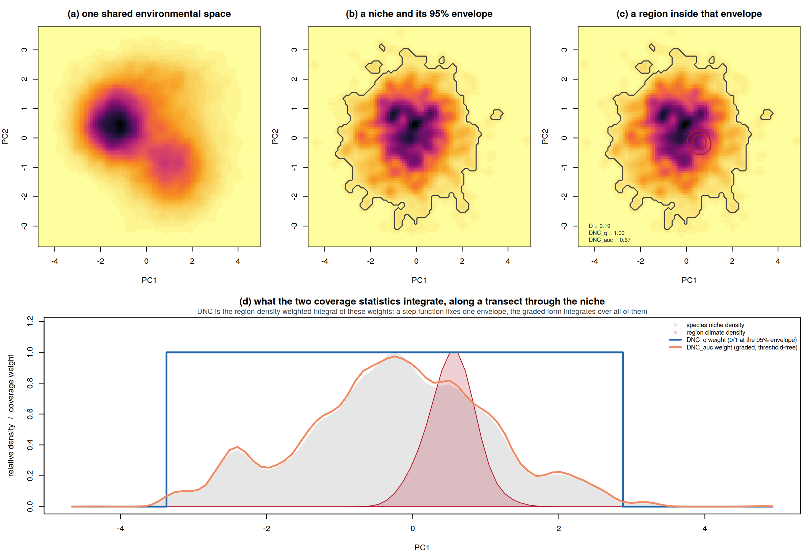
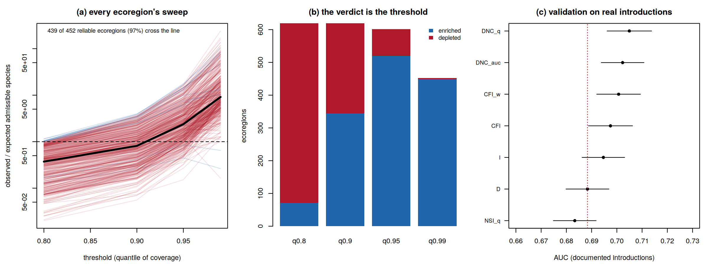

# darkniche

<!-- badges: start -->
[](https://github.com/ehsanrahimi666/darkniche/actions/workflows/R-CMD-check.yaml)
[](https://ehsanrahimi666.github.io/darkniche/)
[](https://www.gnu.org/licenses/gpl-3.0)
[](tests/testthat)
<!-- badges: end -->

**Documentation site:** <https://ehsanrahimi666.github.io/darkniche/>

**Which species are absent from a region although its climate is inside their
tolerance?** `darkniche` answers that question end to end — and makes the two
ways of getting the answer wrong visible in the output instead of hidden in a
footnote.

## The problem

Climatic dark diversity is the set of species a region could hold but does
not. Measuring it requires answering a *containment* question — is this
region's climate inside this species' niche? — but the statistics the field
uses for niche comparison, Schoener's *D* and Warren's *I*, are **symmetric
measures of similarity**. They penalise niche mass lying outside the region,
so a broad-niched species scores near zero against a small region it could
trivially occupy, for the very trait that makes generalists successful
colonisers.

The problem is structural, not a matter of tuning: over unit-mass densities
the min-overlap functional is *identically* Schoener's *D*, so no symmetric
statistic can express containment. `darkniche` asserts that identity in its own
test suite.



In a controlled simulation where admissibility is known from the generating
geometry — never from any evaluated statistic — directional coverage recovers
it at **AUC 0.997 against 0.882 for Schoener's *D*** (paired DeLong z = 28.1).
Thresholded at its own optimum, *D* over-estimates the size of the admissible
pool by **215%**; DNC_q errs by 21%.

## The diagnostic

The standard region-level test — count species above a similarity threshold,
compare with a null expectation — reverses its verdict with the choice of
threshold. On the bundled results for all 619 terrestrial ecoregions:
**71 ecoregions look enriched at the 80th percentile of the coverage
distribution and 449 at the 99th**, and 439 of the 452 reliably testable
ecoregions (97%) change direction somewhere in between.



`dn_sweep()` returns a classed object that says so when you print it —
computed only from thresholds the test itself considers reliable.

## Install

```r
# install.packages("remotes")
remotes::install_github("ehsanrahimi666/darkniche")
```

Not on CRAN — install from GitHub. No hard dependencies beyond base R, so
nothing else needs compiling. To build the vignette as well:

```r
remotes::install_github("ehsanrahimi666/darkniche", build_vignettes = TRUE)
vignette("darkniche-quickstart")
```

### Check the install worked

```r
library(darkniche)

# 1. the bundled global results load, and reproduce the published summary
eco <- dn_data("ecoregion")
nrow(eco)                                    #> 619
round(range(eco$cddr), 3)                    #> 0.022 0.924
round(cor(eco$cddr, log10(eco$area_km2)), 3) #> -0.441

# 2. the algebraic identity the package rests on
sp <- dn_space(cbind(rnorm(3000), rnorm(3000)), R = 60)
Zs <- rbind(as.numeric(dn_density(cbind(rnorm(800, 0, 1.4),
                                        rnorm(800, 0, 1.4)), sp)))
Ze <- rbind(as.numeric(dn_density(cbind(rnorm(300, 0, 0.25),
                                        rnorm(300, 0, 0.25)), sp)))
m <- dn_metrics(Zs, Ze)
all.equal(as.numeric(m$DNC_min), as.numeric(m$D))   #> TRUE
round(c(D = m$D, DNC_q = m$DNC_q, DNC_auc = m$DNC_auc), 3)
#>       D   DNC_q DNC_auc
#>   ~0.17    1.00   ~0.73
# D is low although the region is habitable throughout; only the directional
# forms say so. (Exact values depend on the random draw above.)

# 3. the diagnostic fires on the real data
dn_direction_census(dn_data("sweep"))$census
#>   quantile n_enriched n_depleted
#> 1     0.80         71        548
#> 2     0.90        344        275
#> 3     0.95        520         81
#> 4     0.99        449          3

# 4. the full test suite (needs testthat)
testthat::test_local(system.file(package = "darkniche"))
```

## Use

```r
library(darkniche)

# --- the published global results ship with the package --------------------
eco <- dn_data("ecoregion")          # 619 ecoregions
rep <- dn_report(eco, dn_data("sweep"))
rep
#> Climatic dark-diversity report
#>   regions: 619
#>   CDDR: 0.022 - 0.924 (median 0.579)
#>   area confound: r = -0.441 -- rank on the residual, never on raw CDDR
#>   286 regions move more than 10% of the ranking when area is removed
#>   threshold sweep: 439 of 452 regions (97%) change direction
#>   ** a single-threshold enrichment claim is not supportable here **

# --- or run the workflow on your own data ----------------------------------
sp <- dn_space(global_scores, R = 100)        # one lattice for everything
Zs <- dn_density(species_scores, sp)          # one density per species
Ze <- dn_density(region_scores, sp)           # one density per region

m <- dn_metrics(rbind(as.numeric(Zs)), rbind(as.numeric(Ze)))
nul <- dn_null_shift(Zs, rbind(as.numeric(Ze)), dn_density(global_scores, sp))
dn_null_summary(m$DNC_auc, nul)

pairs <- dn_dark(pair_table, p_min = 0.177, ses_cols = c("n1_ses", "n2_ses"))
cddr  <- dn_cddr(n_dark, n_present, area)     # raw ratio AND area residual

# BEFORE reporting any enrichment result:
sw <- dn_sweep(obs_coverage, null_mean, null_sd)
sw; plot(sw)
```

## What it answers

| Question | Function |
| --- | --- |
| Could this species live in this region, given its climate? | `dn_metrics()` |
| Is that more than a species of its niche breadth achieves anyway? | `dn_null_breadth()` |
| Does the result need the niche to sit where it does? | `dn_null_shift()` |
| Does it need the range to occupy the geography it does? | `dn_null_relocate()` |
| What coverage value should count as "admissible"? | `dn_match()`, `dn_calibrate()` |
| Does directional coverage beat niche similarity at predicting establishment? | `dn_auc()`, `dn_delong()` |
| Which species are absent although the region is admissible? | `dn_dark()` |
| Which regions hold the largest unrealised pools? | `dn_cddr()`, `dn_report()` |
| Does this region hold more admissible species than chance allows? | `dn_aggregate()` |
| Is that answer a property of the region, or of my threshold? | `dn_sweep()` |

## Functions

| Function | Purpose |
| --- | --- |
| `dn_space()`, `dn_density()`, `dn_moments()` | shared lattice; fixed-bandwidth kernel densities; niche moments |
| `dn_envelope()`, `dn_entryq()`, `dn_weights()` | q-envelopes, cumulative density rank, coverage weight vectors |
| `dn_metrics()` | DNC_q, DNC_auc, NSI_q, CFI, CFI_w, NOV + Schoener's *D*, Warren's *I*, BC |
| `dn_null_breadth()`, `dn_null_shift()`, `dn_null_relocate()` | N1 breadth-matched, N2 environmental shift, N3 geographic relocation |
| `dn_ses()`, `dn_null_summary()` | standardised effect sizes with a floored null SD |
| `dn_match()`, `dn_auc()`, `dn_delong()`, `dn_calibrate()` | matched negatives, DeLong AUC and paired tests, Youden calibration |
| `dn_dark()`, `dn_cddr()`, `dn_report()` | conjunction rule, area-adjusted ratio, one-call region report |
| `dn_aggregate()`, `dn_sweep()`, `dn_direction_census()` | region-level test with reliability flags; the threshold-sweep diagnostic |
| `dn_data()` | bundled results for all 619 terrestrial ecoregions |
| `dn_plot_*()` (7) | containment demo, densities, CDDR–area, matrices, sources, ROC, sweeps |
| `dn_table_extremes()`, `dn_table_export()` | paper tables; CSV / Markdown / LaTeX |

## Guardrails you cannot switch off

- `dn_aggregate()` returns `NA` for the effect size, p-value and enrichment
  whenever the expected count is below 5 — a 2,000-fold ratio against an
  expectation of 0.001 species is arithmetic, not evidence.
- `dn_cddr()` returns the area-adjusted residual beside the raw ratio and
  documents that raw CDDR must never rank regions.
- `dn_sweep()` prints its reversal warning from the object itself, so it
  survives into any report that prints the result.

## Data

The package ships **no** range polygons, ecoregion shapefiles or climate
rasters — those are your inputs (IUCN, BirdLife, WWF, WorldClim; all freely
downloadable, too large and licence-restricted to bundle). What it does ship
is the **published output** of the global analysis: 619 ecoregions, 35,087
species, 21,718,853 evaluated pairs, so every example and test runs on real
results.

## Correctness

162 unit tests. 56 of them verify the numerical core against fixtures
generated by an independent Python implementation: kernel density estimation
to within 2e-7 of `scipy.ndimage.gaussian_filter`, all twelve metrics to
within 5e-6, envelopes and the aggregate test exactly, the environmental-shift
null exactly under injected targets. The remaining 106 test behaviour —
including that the sweep's verdict never uses cells the test calls unreliable.

`R CMD check` passes clean; CI runs on Linux, Windows and macOS.

## Documentation

- **<https://ehsanrahimi666.github.io/darkniche/>** — full reference site
- `vignette("darkniche-quickstart")` — worked tutorial
- `manual/darkniche-manual.pdf` — reference manual (28 pp.)
- `manuscript/darkniche_MEE_manuscript.docx` — the software paper
- `analysis/` — scripts regenerating every figure and table in the paper
- `DESIGN.md` — architecture and porting notes

## Reproducing the paper

```bash
Rscript analysis/01_simulation.R    # controlled simulation, Fig. 3, Table 4
Rscript analysis/02_ecoregions.R    # 619 ecoregions, Figs. 4-5, Table 5
Rscript analysis/03_schematics.R    # Figs. 1-2
```

## References

Rahimi, E. & Jung, C. (in review) Directional niche coverage and the climatic
dark diversity of Iranian ecoregions.

Rahimi, E. & Jung, C. (in review) Climatic dark diversity of the world's
terrestrial ecoregions and the threshold dependence of aggregate null-model
tests.

## License

GPL-3.
