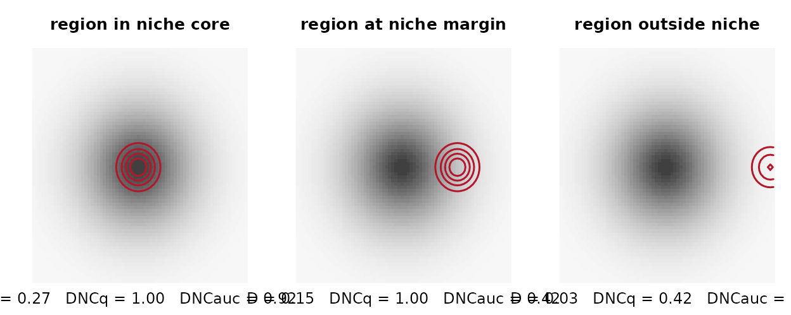
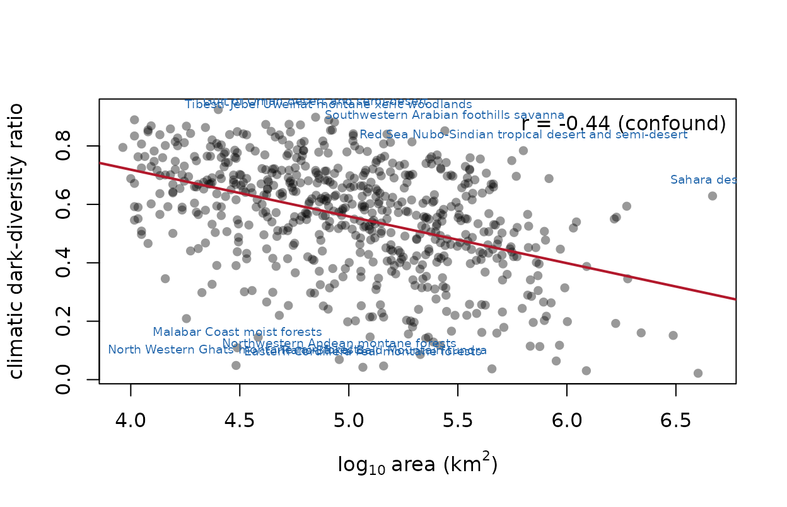

# Climatic dark diversity with darkniche: a quickstart

## 1. Why direction matters

Climatic admissibility is a *containment* question — does the region’s
climate lie inside the species’ tolerance? — not a similarity question.
Symmetric overlap statistics penalise niche mass lying outside the
region, so a broad-niched species scores near zero against a small
region it could trivially occupy.

``` r

sp     <- dn_space(cbind(rnorm(5000, 0, 2), rnorm(5000, 0, 2)), R = 70)
broad  <- dn_density(cbind(rnorm(2000, 0, 1.6), rnorm(2000, 0, 1.6)), sp)
region <- dn_density(cbind(rnorm(500,  0, 0.25), rnorm(500,  0, 0.25)), sp)

m <- dn_metrics(rbind(as.numeric(broad)), rbind(as.numeric(region)))
round(c(D = m$D, I = m$I, DNC_q = m$DNC_q, DNC_auc = m$DNC_auc), 3)
#>       D       I   DNC_q DNC_auc 
#>   0.192   0.431   1.000   0.923
```

`D` is low; the directional forms are high. The region is habitable
throughout, and only the directional family says so.

``` r

dn_plot_containment(R = 70)
```



The algebraic reason is checked in the package’s own test suite: over
unit-mass densities the min-overlap functional is *identically*
Schoener’s *D*, so no symmetric statistic can be rescaled into a
containment measure.

``` r

all.equal(as.numeric(m$DNC_min), as.numeric(m$D))
#> [1] TRUE
```

## 2. The workflow on your own data

``` r

# 1. one lattice from the global background (e.g. two climate PCs)
sp <- dn_space(global_scores, R = 100)

# 2. one density per species and per region, same bandwidth for all
Zs <- dn_density(species_scores, sp)
Ze <- dn_density(region_scores,  sp)

# 3. the metric block
m <- dn_metrics(Zs_matrix, Ze_matrix, q = 0.95)

# 4. null screens
Zg  <- dn_density(global_scores, sp)
nul <- dn_null_shift(Zs, Ze_matrix, Zg, B = 499)
dn_null_summary(m$DNC_auc, nul)

# 5. calibrate the admissibility threshold on documented introductions
neg <- dn_match(positives, regions, reached)
thr <- dn_calibrate(scores, labels)

# 6. classify
pairs <- dn_dark(pair_table, p_min = thr, ses_cols = c("n1_ses", "n2_ses"))
```

The package ships no range polygons or rasters — those are your inputs
(IUCN, BirdLife, WWF, WorldClim). What it does ship is real published
output.

## 3. The bundled global results

``` r

eco <- dn_data("ecoregion")
str(eco)
#> 'data.frame':    619 obs. of  5 variables:
#>  $ region  : chr  "Sinaloan dry forests" "Everglades" "Veracruz moist forests" "Hispaniolan moist forests" ...
#>  $ n_obs   : int  864 267 1051 277 302 1177 874 553 1532 1802 ...
#>  $ n_dark  : int  1651 1684 1350 1267 1382 2020 1363 1652 793 958 ...
#>  $ cddr    : num  0.656 0.863 0.562 0.821 0.821 ...
#>  $ area_km2: num  93200 22000 92800 49600 23600 ...
dn_data("auc")
#>     metric     n n_pos       auc          se        lo        hi
#> 1    DNC_q 18899  3480 0.7049489 0.004504626 0.6961200 0.7137778
#> 2  DNC_auc 18899  3480 0.7022837 0.004324280 0.6938083 0.7107591
#> 3  DNC_min 18899  3480 0.6883640 0.004339415 0.6798589 0.6968691
#> 4    NSI_q 18899  3480 0.6833160 0.004325208 0.6748388 0.6917933
#> 5      CFI 18899  3480 0.6974737 0.004457697 0.6887367 0.7062106
#> 6    CFI_w 18899  3480 0.7006914 0.004426512 0.6920156 0.7093672
#> 7      NOV 18899  3480 0.2855750 0.004264521 0.2772167 0.2939333
#> 8        D 18899  3480 0.6883598 0.004339569 0.6798544 0.6968652
#> 9        I 18899  3480 0.6946552 0.004308862 0.6862100 0.7031005
#> 10      BC 18899  3480 0.6946552 0.004308862 0.6862100 0.7031005
```

[`dn_report()`](https://ehsanrahimi666.github.io/darkniche/reference/dn_report.md)
assembles the quantities a region-level study must report together.

``` r

rep <- dn_report(eco, dn_data("sweep"))
rep
#> Climatic dark-diversity report
#>   regions: 619
#>   CDDR: 0.022 - 0.924 (median 0.579)
#>   area confound: r = -0.441 -- rank on the residual, never on raw CDDR
#>   286 regions move more than 10% of the ranking when area is removed
#>   threshold sweep: 439 of 452 regions (97%) change direction
#>   direction census by threshold:
#>  quantile n_enriched n_depleted
#>      0.80         71        548
#>      0.90        344        275
#>      0.95        520         81
#>      0.99        449          3
#>   ** a single-threshold enrichment claim is not supportable here **
```

Note what the printed report insists on.

## 4. Guardrail 1 — never rank on the raw ratio

A small region occupies little environmental space, so more niches
enclose it, while its smaller area supports fewer natives. Both inflate
the raw ratio for reasons unrelated to the ecology of interest.

``` r

x <- dn_cddr(eco$n_dark, eco$n_obs, eco$area_km2)
attr(x, "confound_r")
#> [1] -0.4407015
# the residual is orthogonal to area by construction
round(cor(x$cddr_residual, log10(eco$area_km2)), 12)
#> [1] 0
```

``` r

dn_plot_cddr_area(x, eco$area_km2, labels = eco$region)
```



## 5. Guardrail 2 — check the threshold before claiming a direction

The region-level test counts species above a threshold and compares that
count with its Poisson-binomial expectation under the null. Results
whose expected count falls below five are not reported at all:

``` r

obs <- c(rbeta(300, 0.3, 5), rbeta(100, 9, 1.1))
mu  <- rbeta(400, 2.5, 2.5); sdv <- 0.18 + 0.06 * runif(400)
dn_aggregate(obs, mu, sdv, threshold = quantile(obs, 0.95))
#>   n_species n_admissible_obs expected       sd       ses         p enrichment
#> 1       400               20  19.5729 3.981904 0.1072604 0.4572912   1.021821
#>   reliable
#> 1     TRUE
```

And the direction of that verdict is often a property of the threshold
rather than of the region:

``` r

sw <- dn_sweep(obs, mu, sdv)
sw
#> Threshold sweep of the aggregate null test
#>   thresholds: q0.80 - q0.99 (20 points)
#>   obs/expected ratio: 0.235 - 1.699
#>   ** DIRECTION REVERSES across the sweep: a single-threshold
#>      verdict for this region is an artefact of the threshold. **
```

``` r

plot(sw)
```


Across all 619 bundled ecoregions:

``` r

cen <- dn_direction_census(dn_data("sweep"))
cen$census
#>   quantile n_enriched n_depleted
#> 1     0.80         71        548
#> 2     0.90        344        275
#> 3     0.95        520         81
#> 4     0.99        449          3
sprintf("%d of %d reliably testable ecoregions change direction (%.0f%%)",
        cen$n_changed, cen$n_regions, 100 * cen$frac_changed)
#> [1] "439 of 452 reliably testable ecoregions change direction (97%)"
```

The same data support opposite worldwide conclusions depending on where
the threshold is put. Report the sweep, not a single value.

## 6. Figures and tables for a paper

``` r

ext <- dn_table_extremes(eco$region, x, n_obs = eco$n_obs,
                         n_dark = eco$n_dark, n = 5)
head(ext, 5)
#>                                                   region      cddr  residual
#> 444               Southwestern Arabian foothills savanna 0.8518351 0.3635856
#> 376 Red Sea Nubo-Sindian tropical desert and semi-desert 0.7838773 0.3532864
#> 419                                        Sahara desert 0.6287016 0.3370001
#> 276        Tibesti-Jebel Uweinat montane xeric woodlands 0.8887833 0.3152269
#> 438                  Gulf of Oman desert and semi-desert 0.8983205 0.3151845
#>     n_obs n_dark
#> 444   327   1880
#> 376   437   1585
#> 419   489    828
#> 276   117    935
#> 438   224   1979
```

[`dn_table_export()`](https://ehsanrahimi666.github.io/darkniche/reference/dn_table_export.md)
writes any table to CSV, Markdown or LaTeX, and
[`dn_plot_matrix()`](https://ehsanrahimi666.github.io/darkniche/reference/dn_plot_matrix.md),
[`dn_plot_sources()`](https://ehsanrahimi666.github.io/darkniche/reference/dn_plot_sources.md),
[`dn_plot_roc()`](https://ehsanrahimi666.github.io/darkniche/reference/dn_plot_roc.md)
and
[`dn_plot_sweeps()`](https://ehsanrahimi666.github.io/darkniche/reference/dn_plot_sweeps.md)
cover the remaining figure types. The scripts in `analysis/` regenerate
every figure and table of the software paper.
